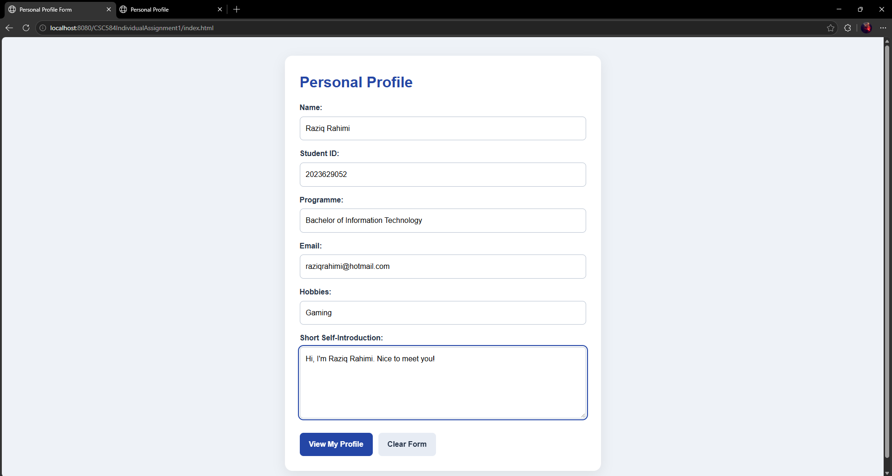
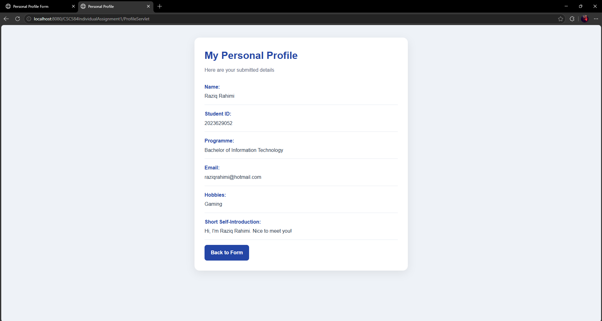

# CSC584 Individual Assignment 1

Hi, I'm Raziq Rahimi bin Sofian (2026129983) from CS2404C!

This is a Personal Profile Web Application that collects information through an HTML form, processes it using a Java Servlet with HTTP POST, and displays the submitted profile on a JSP page.

## Features

- Collects name, student ID, programme, email, hobbies, and a short self-introduction.
    
- Checks required fields and email format through browser validation.
    
- Displays the submitted details on a styled profile page.
    
- Provides a responsive layout and a form reset button.
    
- Uses no database.

## Technologies

- HTML5
    
- CSS3
    
- Java Servlet
    
- JavaServer Pages (JSP)
    
- JSTL
    
- Java EE 7 Web
    
- NetBeans IDE 8.2
    
- GlassFish Server 4.1.1

## Requirements

- JDK 8
    
- NetBeans IDE 8.2 with Java Web support
    
- GlassFish Server 4.1.1

## How to Run

1. Download or clone this repository. Extract it if downloaded as a ZIP.
    
2. Open NetBeans and select File → Open Project.
    
3. Select the project folder containing build.xml and nbproject.
    
4. In the project properties, confirm that the Java platform points to JDK 8.
    
5. Under Run, select your registered GlassFish Server 4.1.1.
    
6. Right-click the project and select Clean and Build.
    
7. Right-click index.html under Web Pages and select Run File.
    
8. Complete the form and click View My Profile.

With the default port and configured context path, the form is available at:

[http://localhost:8080/CSC584IndividualAssignment1/index.html](http://localhost:8080/CSC584IndividualAssignment1/index.html)

Adjust the address if your server uses a different port or context path. The application must run through GlassFish.

## Application Flow

HTML Form → ProfileServlet (HTTP POST) → profile.jsp

The Servlet reads the form parameters, stores them as request attributes, and forwards the request to the JSP for display.

## Screenshots

### Profile Form

### Profile Result

